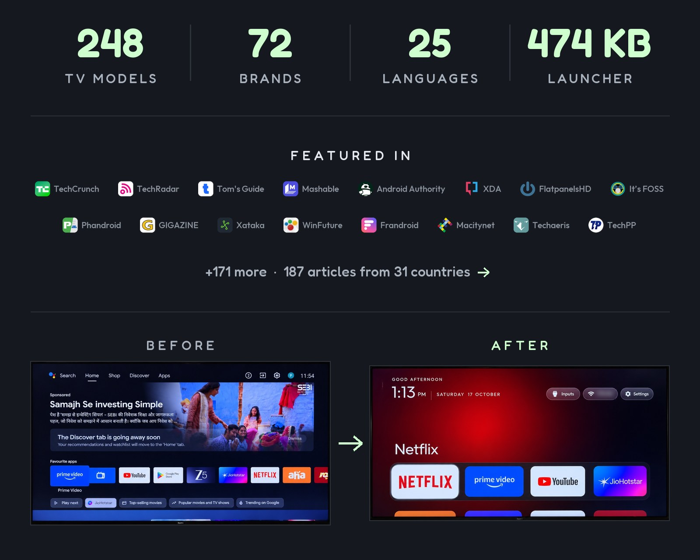
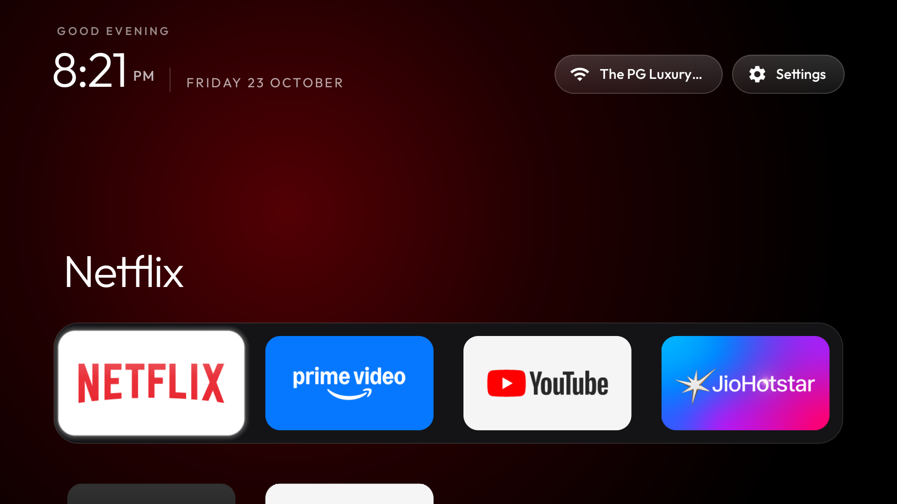
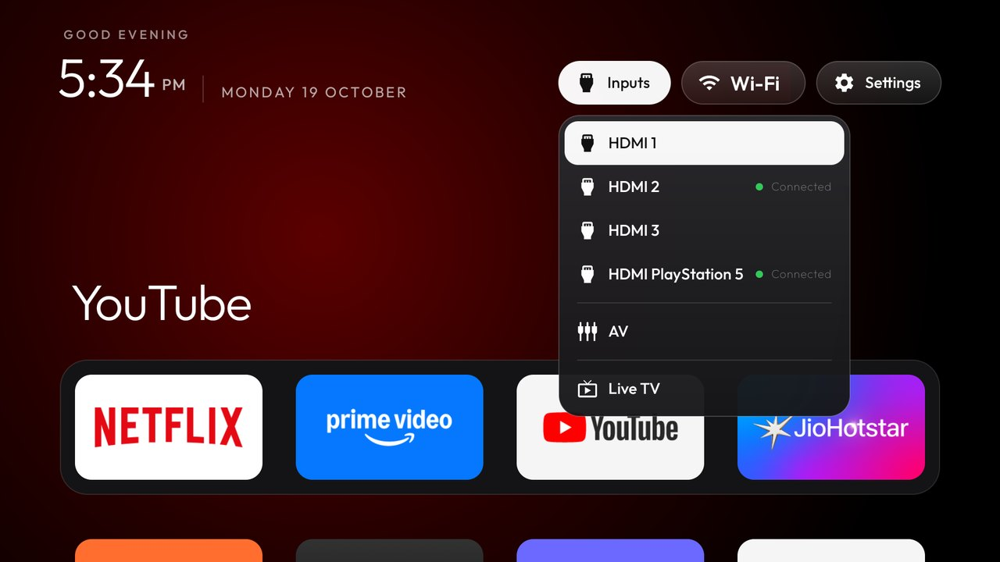
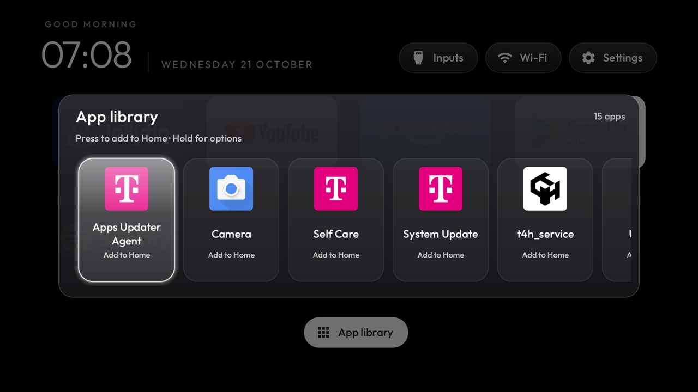

# 🍎 tvOS — Apple TV Experience & Deep Debloater for Android TV

[](LICENSE)
[]()
[]()
[]()

<p align="center">
  
</p>

<p align="center">
  
</p>

---

## 🌟 What It Does

This project transforms your **Android TV**, **Mi TV Stick**, or **Streaming Box** into a lightning-fast, ad-free **Apple TV-style home screen**, while eliminating heavy background bloatware.

* **✨ Apple TV Glass UI**: Beautiful frosted dock, top menu bar with live clock, Wi-Fi pill, quick settings, and fluid animations.
* **⚡ Massive RAM Boost**: Reclaims **+215 MB of RAM** (more than doubling available memory on 1 GB sticks like the Mi TV Stick) by eliminating background memory pressure.
* **🚫 Zero Ads & Zero Bloat**: Disables Xiaomi PatchWall, sponsored promotional carousels, Google TV recommendation pollers, and telemetry.
* **🛡️ 100% Safe & Reversible**: Every package is disabled safely (`pm disable-user --user 0`) — never uninstalled. No root required, and any app can be re-enabled instantly.
* **🔒 Keeps What Matters**: Official Google Play Store, Voice Assistant, Bluetooth remote control, hardware video decoders, and Chromecast casting remain fully functional.

---

## 📸 Interface & Features Showcase

| Ambient Glow Top Shelf | Inputs & Tuner Menu |
| :---: | :---: |
|  |  |
| **Clock Screensaver** | **App Library & Tile Reordering** |
|  |  |

---

## 📊 Live RAM Benchmark (Mi TV Stick 1 GB)

| Metric | Stock Android TV | After tvOS Setup & Debloat | Improvement |
| :--- | :--- | :--- | :--- |
| **System Memory Status** | 🔴 `critical` | 🟢 `moderate` | **Pressure Relieved** |
| **Free / Available RAM** | `137 MB` | **`353 MB`** | **+216 MB (2.5x more free RAM!)** |
| **Active Memory Usage (PSS)** | `577 MB` | **`394 MB`** | **180 MB reclaimed** |
| **UI Responsiveness** | Stutter & remote lag | 60 FPS smooth | **Instant navigation** |

---

## 🚀 Step-by-Step Installation Guide

### Prerequisites: Enable ADB on Your TV
1. Turn on your TV / Mi TV Stick.
2. Go to **Settings** → **Device Preferences** → **About**.
3. Scroll down to **Build / Android TV OS Build** and click the **OK** button on your remote **7 times** until you see *"You are now a developer!"*.
4. Go back to **Settings** → **Device Preferences** → **Developer Options**.
5. Toggle ON **USB Debugging** (and **Network Debugging** if listed).
6. Find your TV's local IP address under **Settings** → **Network & Internet** → your connected Wi-Fi (e.g. `192.168.1.113`).

---

### Step 1: Clone This Repository
Open your computer's terminal and run:
```bash
git clone https://github.com/isachins/tvOS.git
cd tvOS
```

---

### Step 2: Install Apple TV Launcher & Set Home Screen
Run the automated installer with your TV's IP address:

```bash
python3 scripts/install_mistick.py <YOUR_TV_IP>
```
*Example:*
```bash
python3 scripts/install_mistick.py 192.168.1.113
```
> 👉 **Look at your TV screen:** When the prompt *"Allow USB debugging?"* appears, check **"Always allow from this computer"** and click **OK**.

The script will automatically connect over Wi-Fi, install the Apple TV launcher APK, set it as the default Home screen, and disable the stock launcher.

---

### Step 3: Run the Deep Debloater (Free +215 MB RAM)
Run the dedicated debloat script to disable 40+ unused system apps, background loggers, and hardware stubs:

```bash
chmod +x scripts/debloat_mistick.sh
./scripts/debloat_mistick.sh <YOUR_TV_IP>
```
*Example:*
```bash
./scripts/debloat_mistick.sh 192.168.1.113
```

#### What this safely disables:
* **Dead Media Apps**: Google Play Music (huge 37 MB RAM hog!), Play Games, Play Movies, Live Channels (tuner app on a tunerless stick).
* **Useless Hardware Stubs**: Camera service (`camera2`), Print Spooler (`printspooler`), NFC (`com.android.se`), External SD/USB storage daemon (`externalstorage`), SMS push.
* **Background Telemetry**: Xiaomi PatchWall analytics (`miui.tv.analytics`), Google bug report gatherers, partner app auto-installers.
* **Unused Sync**: Contacts & Calendar sync, cloud backup transports, stock launcher ad recommendation pollers.
* **Accessibility**: TalkBack screen reader and text-to-speech engine (unless needed).

---

### Step 4: Done! Enjoy Your Apple TV Interface
Press the **Home button** on your remote. Your TV will instantly wake up to the clean Apple TV home screen with fluid navigation and maximum free memory.

---

## 💡 Handy Tips & Tricks

### 1. Close Recent Apps (Native App Switcher)
To see all currently open apps (YouTube, Netflix, Prime Video) and close them:
* **Double-press the Home button** (or press & hold the Home button for 2 seconds) on your remote.
* The native Android TV app switcher will open. Click **`✕`** on any app to cleanly close it and free its memory.

### 2. How to Re-Enable Any Disabled App
Because apps are disabled and never deleted, you can re-enable any individual app anytime over ADB:
```bash
./platform-tools/adb shell pm enable <package-name>
# Example: ./platform-tools/adb shell pm enable com.google.android.play.games
```

### 3. Switch Themes & Wallpapers
You can apply pre-built glass themes and 4K wallpapers included in the `themes/` folder:
```bash
TV_HOST=<YOUR_TV_IP> tools/theme.sh themes/sweden
# Available themes: classic, noir, midnight, warm, ice, forest, sweden, retro
```

---

## 📜 Credits & License

* Reference launcher core powered by the open-source [CleanYourTV](https://github.com/Gathin23/cleanyourtv) project under the MIT License.
* Automation tools and deep debloat profiles tailored for Mi TV Stick (`MiTV-AESP0`, `aquaman`) and streaming sticks by [Sachin Sharma](https://github.com/isachins).
